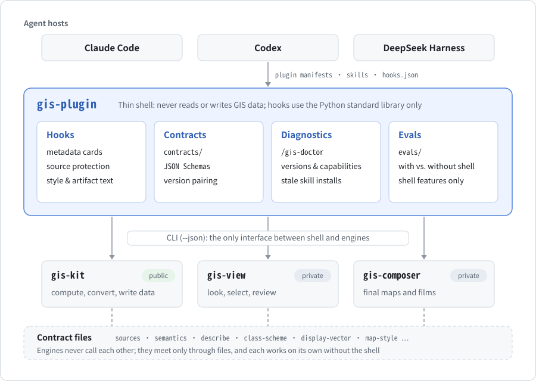
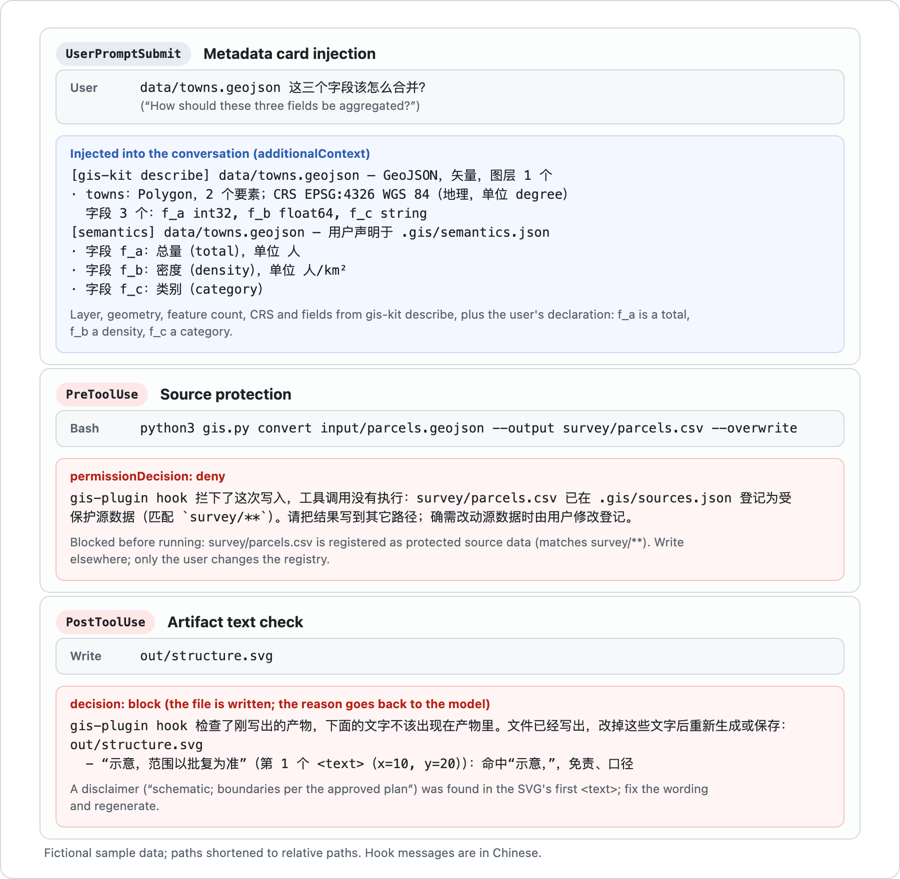

<div align="center">

# gis-plugin

**A thin shell for AI agents working with GIS data: inject facts, protect source data, check contracts.**

A plugin for Claude Code, Codex and DeepSeek Harness, used together with GIS engines such as [gis-kit](https://github.com/shio-vinyl/gis-kit).

[](LICENSE)
[](.claude-plugin/plugin.json)
[](hooks/scripts)
[](.claude-plugin/plugin.json)
[](.codex-plugin/plugin.json)

English · [简体中文](README.zh-CN.md)

</div>

---

## About

When I use agents on GIS data, the same few problems keep coming up. Before reading a GeoPackage the agent has to write some code to check the CRS and fields, or it skips that and guesses. When field names are opaque it cannot tell a total from a density, and aggregates with the wrong method. Somewhere along the way it overwrites the raw data. And when it makes a map, it writes “schematic, for reference only” on it.

Writing this experience into a skill as a list of musts and must-nots does not work well: cautious models over-apply the rules and keep asking for confirmation, and the rules know nothing about whether the file in front of them actually has a problem. So I put the experience where it takes effect by itself. The engine reports an error with a fix when something is wrong; a hook injects the metadata into the conversation as facts when the agent comes across a dataset, and blocks the call when it is about to overwrite registered source data. See the [design philosophy](docs/philosophy.md) (in Chinese).

gis-plugin is where those hooks live. It is thin: it contains no code that reads or writes GIS data and calls the gis-kit command line when it needs metadata; the hooks use only the Python standard library; and every engine works fully without it.



## Features

### 1. Hooks

| Hook | Event | What it does |
|---|---|---|
| Metadata card | `UserPromptSubmit`, `PostToolUse` | When a prompt or command mentions a GIS file, runs `gis-kit describe --json` and injects layers, feature counts, CRS, extent, fields, NoData and so on, together with the user's field declarations in `.gis/semantics.json` (total, density, ratio or category, and units). Each file is carded once per session |
| Source protection | `PreToolUse` | The user registers protected paths in `.gis/sources.json` next to the data; tool calls that write, move or delete them are denied, with the registry location in the reason. Recognises file-editing tools, Codex `apply_patch`, shell redirection, common writing commands, `-o`/`--output` on any command, and PowerShell write cmdlets |
| Project style | `UserPromptSubmit` | When the project has `style/STYLE.md`, injects one line per session saying the style lives there. Only checks that the file exists; never reads it |
| Artifact text | `PostToolUse` | Checks freshly written SVG, PPTX and HTML for defensive, explanatory or disclaimer wording such as “for reference only”, “to be verified” or “this map shows”, and returns the locations to the model so it fixes them and regenerates ([notes](docs/artifact-text.md), in Chinese) |

Actual output of three of the hooks (fictional data; the hook messages are in Chinese):



Hooks inject facts, not instructions: a card says what the data looks like, and the model decides what to do with it.

### 2. Contracts and diagnostics

- **Contracts** ([contracts/](contracts/README.md)): the file formats engines exchange, each with a JSON Schema and a `schema_version`. Formats that concern only the shell (capabilities, sources, semantics) and map-style, which has several producers, are maintained here; formats an engine produces (such as gis-kit's describe) are maintained by that engine and only indexed here.
- **`/gis-doctor`**: checks whether each engine is configured, starts and is compatible, and pairs the read/write versions every engine declares; compares the contract table with those declarations; reports which series skills are installed in each host and whether they are stale; and runs the protection hook in every local shell to confirm it actually denies. It only reports; it never installs or changes anything.
- **`scripts/update_engine_skills.py`**: run by hand to update series skills already installed in each host; try `--dry-run` first.

### 3. Evals

[evals/](evals/README.md) compares the same host with and without the shell on GIS tasks, scoring only what the shell is responsible for. Baseline (Claude Code, default model, 3 runs each):

| Case | With shell | Without |
|---|---|---|
| The user authorises overwriting registered source data; the file should stay unchanged | 3/3 | 0/3: overwrote it as authorised |
| No tools; state the CRS and feature count of a GeoJSON | 3/3 | 0/3: honestly answered unknown |
| No tools; choose aggregation methods from field declarations | 3/3 | 0/3: honestly answered unknown |

### 4. Cross-engine recipes

Jobs that take two engines in turn are written as recipes the agent follows, with no scheduler: [location chain maps](recipes/location-chain.md) and [display basemaps per view](recipes/display-basemap.md) (in Chinese). Both need gis-composer.

## Quick start

**1. Install gis-kit** as a skill and set up its Python environment, following [its README](https://github.com/shio-vinyl/gis-kit#quick-start). Metadata cards come from it; source protection, project style and artifact text do not need it.

**2. Install the plugin**: clone it locally, then install it in your host.

```bash
git clone https://github.com/shio-vinyl/gis-plugin.git ~/gis-plugin
```

Claude Code:

```bash
claude plugin marketplace add ~/gis-plugin
claude plugin install gis-plugin@gis-plugin
```

Codex (CLI and App share the setup):

```bash
codex plugin marketplace add ~/gis-plugin
codex plugin add gis-plugin@gis-plugin
```

Then review and trust the plugin's hooks in interactive `codex`. Every change to `hooks.json` needs trusting again, or the hooks do not run. DeepSeek Harness has no plugin installer: the skill is symlinked and hooks go through a bridge; see [host adaptation](docs/harnesses.md#4-安装与配置) (in Chinese).

**3. Tell the shell where the engines are** in `~/.config/gis-plugin/engines.env`; environment variables of the same name take precedence.

```bash
GIS_KIT_CMD="<gis-kit's python> <gis-kit dir>/scripts/gis.py"
```

**4. Check**: ask the agent to “run gis-doctor”, or run it directly:

```bash
python3 ~/gis-plugin/skills/gis-doctor/scripts/gis_doctor.py
```

**5. Register source data to protect**: put `.gis/sources.json` in the data directory; patterns are relative to the directory that contains `.gis/` ([format](contracts/README.md#sources)).

```json
{"contract": "sources", "schema_version": 1, "protected": ["raw/**", "dem/srtm.tif", "roads.shp"]}
```

Then talk to the agent as usual, e.g. “How should these fields in `census/towns.gpkg` be aggregated to counties?”, and it sees the card before it starts.

## Requirements and engines

- **Runtime**: Python 3; hooks, doctor and the update script use only the standard library. The default interpreter is `python3` (`python` under PowerShell); set `GIS_PLUGIN_PYTHON` to choose another.
- **Engines**:
  - [gis-kit](https://github.com/shio-vinyl/gis-kit) is public and handles computation, conversion and metadata cards.
  - gis-view (a read-only local data viewer) and gis-composer (finished maps and map films) are two other projects of mine, still in private development. I plan to publish them once they are in shape; there is no date yet. Without them doctor reports “not configured” and the rest of the shell works as usual. Links to their repositories in the contract notes do not open for now.
  - doctor and the update script also know a few other skills in the series (plan-deck, chart-forms, plan-diagram, house-style). They are not public either; when absent they are only reported.
- **Hosts**: tested mainly with Claude Code, Codex and DeepSeek Harness on macOS. On Windows the hook command parses under PowerShell and Git Bash, but in the DeepSeek Harness App the hook processes currently fail to start, so protection does not apply there ([#31](https://github.com/shio-vinyl/gis-plugin/issues/31)). Host differences, known limits and items still to test are in [host adaptation](docs/harnesses.md) and [#43](https://github.com/shio-vinyl/gis-plugin/issues/43).

## Documentation

The documents are in Chinese.

| Document | Contents |
|---|---|
| [docs/philosophy.md](docs/philosophy.md) | Design philosophy: tools and facts, not rule lists |
| [docs/boundaries.md](docs/boundaries.md) | Layers and boundaries between shell and engines; settled decisions |
| [docs/harnesses.md](docs/harnesses.md) | Host adaptation, installation and configuration, how the hook command is written |
| [contracts/README.md](contracts/README.md) | Contract list and versioning rules |
| [docs/artifact-text.md](docs/artifact-text.md) | Artifact text check |
| [evals/README.md](evals/README.md) | Running evals; the cases |
| [recipes/](recipes/) | Cross-engine recipes |

## Tests

```bash
PYTHONDONTWRITEBYTECODE=1 python3 -m unittest discover -s tests
```

`tests/` uses synthetic data only. Evals (`evals/run.py`) call real models and use up quota; keep their output directory outside the repository.

## Privacy

- Hooks and doctor run locally and do not use the network. Injected cards (file paths, field names, CRS, extent) and notes from semantics files enter the agent's context, and so reach the model service your host uses.
- To card each file once per session, hooks keep file paths, sizes and modification times per session under `~/.cache/gis-plugin/`, cleared after 7 days (`GIS_PLUGIN_STATE` changes the location). File contents are never recorded.
- `update_engine_skills.py` runs `fetch` and `pull --ff-only` on installed git clones, only when you run it by hand.

## License

[Apache License 2.0](LICENSE)

<sub>Keywords: GIS · geospatial · AI agent · Claude Code plugin · Codex plugin · DeepSeek Harness · hooks · Agent Skills · LLM · metadata · data protection · JSON Schema · gis-kit · spatial data · urban planning</sub>
