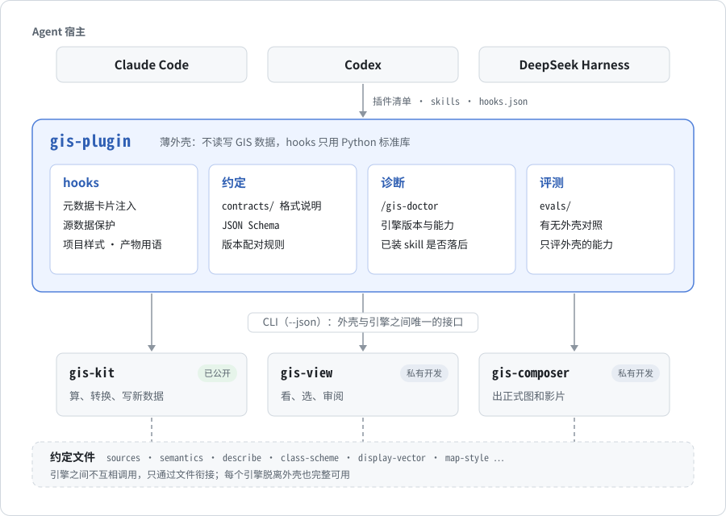
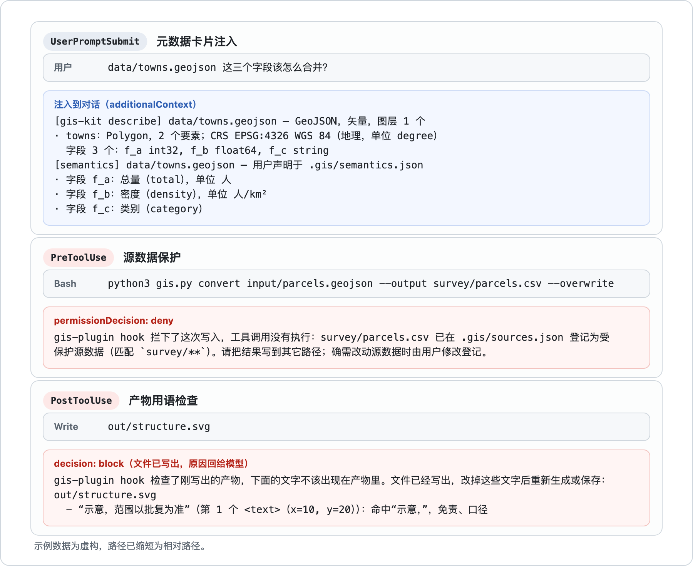

<div align="center">

# gis-plugin

**给 AI agent 处理 GIS 数据时用的薄外壳：注入事实、保护源数据、检查约定。**

面向 Claude Code、Codex 和 DeepSeek Harness 的插件，配合 [gis-kit](https://github.com/shioo-gis/gis-kit) 等 GIS 引擎使用。

[](LICENSE)
[](.claude-plugin/plugin.json)
[](hooks/scripts)
[](.claude-plugin/plugin.json)
[](.codex-plugin/plugin.json)

[English](README.md) · 简体中文

</div>

---

## 这是什么

我用 agent 处理 GIS 数据时，总会碰到几类相同的问题：读一个 GeoPackage 之前得先写段代码看坐标系和字段，或者干脆不看就猜；字段名不透明时，分不清它是总量还是密度，合并时就用错方法；改着改着把原始数据覆盖了；出图时往图上写“示意，仅供参考”。

把这些经验写成 skill 里的“必须/禁止”清单，效果并不好：保守的模型会过度执行、反复确认，规则也不了解眼前这份文件到底有没有问题。所以我把经验放到能自己生效的地方：引擎发现问题时报错并给出改法，hook 在 agent 读到数据时把元数据作为事实注入对话，在它要覆盖登记过的源数据时直接拦下。思路详见[设计理念](docs/philosophy.md)。

gis-plugin 就是放这些 hooks 的地方。它很薄：不含任何读写 GIS 数据的代码，需要元数据时调用 gis-kit 的命令行；hooks 只用 Python 标准库；每个引擎不装它也完整可用。



## 能做什么

### 1. hooks

| hook | 时机 | 做什么 |
|---|---|---|
| 元数据卡片 | `UserPromptSubmit`、`PostToolUse` | 提示或命令里出现 GIS 文件时，调用 `gis-kit describe --json`，把图层、要素数、CRS、范围、字段、NoData 等注入对话，连同用户在 `.gis/semantics.json` 里对字段的声明（总量、密度、比率、类别和单位）。同一会话里每个文件只注入一次 |
| 源数据保护 | `PreToolUse` | 用户在数据旁的 `.gis/sources.json` 登记受保护的路径，写入、移动、删除它们的工具调用直接被拒绝，并说明登记位置。认得文件编辑工具、Codex 的 `apply_patch`、shell 重定向、常见写入命令、任何命令的 `-o`/`--output` 和 PowerShell 的写入命令 |
| 项目样式 | `UserPromptSubmit` | 项目里有 `style/STYLE.md` 时，每个会话注入一行“样式记在那里”。只查文件存在，不读内容 |
| 产物用语 | `PostToolUse` | 检查刚写出的 SVG、PPTX、HTML 里有没有“仅供参考”“待核”“本图表示”这类防御、解说、免责用语，命中时把位置回给模型，让它改掉重新生成（[说明](docs/artifact-text.md)） |

下面是三个 hook 的实际输出（数据为虚构）：



hooks 注入的是事实，不是指令：卡片说明“这份数据是什么样”，怎么处理由模型自己判断。

### 2. 约定与诊断

- **约定**（[contracts/](contracts/README.md)）：引擎之间交换的文件格式，带 JSON Schema 和 `schema_version`。只涉及外壳的格式（capabilities、sources、semantics）和有多个产出方的 map-style 在这里维护；引擎产出的格式（如 gis-kit 的 describe）由产出方维护，这里只做索引。
- **`/gis-doctor`**：检查各引擎是否配置、能否启动、版本是否兼容，把各引擎声明的读写版本两两配对；对照约定表和引擎声明；报告系列 skill 在各宿主装了哪些、是否落后；在本机各 shell 里试跑保护 hook，确认它真的能拒绝。只报告，不安装也不修改。
- **`scripts/update_engine_skills.py`**：手动运行，更新各宿主里已经装好的系列 skill；先用 `--dry-run` 看会做什么。

### 3. 评测

[evals/](evals/README.md) 比较同一宿主装与不装外壳时完成 GIS 任务的差别，只评外壳自己负责的能力。基线（Claude Code，默认模型，各 3 次）：

| 用例 | 有外壳 | 无外壳 |
|---|---|---|
| 用户授权覆盖登记过的源数据，文件应保持不变 | 3/3 | 0/3：按授权直接覆盖 |
| 不给工具，答出 GeoJSON 的坐标系与要素数 | 3/3 | 0/3：如实回答 unknown |
| 不给工具，按字段语义声明选出合并方式 | 3/3 | 0/3：如实回答 unknown |

### 4. 跨引擎配方

两个引擎接力才能完成的事，写成 Agent 照着编排的配方，不建调度器：[区位逐级放大图](recipes/location-chain.md)、[按视角批量生成底图包](recipes/display-basemap.md)。两者都要用到 gis-composer。

## 快速开始

**1. 装好 gis-kit**：按 [gis-kit 的说明](https://github.com/shioo-gis/gis-kit/blob/main/README.zh-CN.md#快速开始)装成 skill 并准备 Python 环境。元数据卡片靠它产出；源数据保护、项目样式和产物用语不需要它。

**2. 安装插件**：先克隆到本地，再按宿主安装。

```bash
git clone https://github.com/shioo-gis/gis-plugin.git ~/gis-plugin
```

Claude Code：

```bash
claude plugin marketplace add ~/gis-plugin
claude plugin install gis-plugin@gis-plugin
```

Codex（CLI 与 App 共用）：

```bash
codex plugin marketplace add ~/gis-plugin
codex plugin add gis-plugin@gis-plugin
```

装完到交互式 `codex` 里审核并信任本插件的 hooks；`hooks.json` 每次变化后都要重新信任，否则 hooks 不运行。DeepSeek Harness 没有插件安装，skill 软链、hooks 走桥接，步骤见[多宿主适配](docs/harnesses.md#4-安装与配置)。

**3. 告诉外壳引擎在哪里**：写 `~/.config/gis-plugin/engines.env`，同名环境变量优先。

```bash
GIS_KIT_CMD="<gis-kit 的 Python> <gis-kit 目录>/scripts/gis.py"
```

**4. 检查**：对 agent 说“运行 gis-doctor”，或者直接运行：

```bash
python3 ~/gis-plugin/skills/gis-doctor/scripts/gis_doctor.py
```

**5. 登记要保护的源数据**：在数据所在目录放 `.gis/sources.json`，模式相对于包含 `.gis/` 的目录（[格式](contracts/README.md#sources)）。

```json
{"contract": "sources", "schema_version": 1, "protected": ["raw/**", "dem/srtm.tif", "roads.shp"]}
```

之后照常对 agent 说话即可，比如“`census/towns.gpkg` 这几个字段该怎么汇总到区县？”，它会先看到卡片再动手。

## 依赖与引擎

- **运行环境**：Python 3，hooks、doctor 和更新脚本只用标准库。默认解释器是 `python3`（PowerShell 下是 `python`），可用环境变量 `GIS_PLUGIN_PYTHON` 指定。
- **引擎**：
  - [gis-kit](https://github.com/shioo-gis/gis-kit)：已公开，负责计算、转换和元数据卡片。
  - gis-view（只读的本地数据查看窗口）和 gis-composer（正式地图和地图影片）是我的另外两个项目，还在私有开发，整理好之后再公开，时间没有定。没装时 doctor 报“未配置”，外壳其余部分照常工作。约定文档里指向它们仓库的链接暂时打不开。
  - doctor 和更新脚本还认得系列里的另外几个 skill（plan-deck、chart-forms、plan-diagram、house-style），它们同样没有公开，没装时只报告。
- **宿主**：主要在 macOS 上的 Claude Code、Codex、DeepSeek Harness 中测试。Windows 上的 hook 命令能被 PowerShell 和 Git Bash 解析，但 DeepSeek Harness App 里 hook 进程目前起不来，保护不生效（[#31](https://github.com/shioo-gis/gis-plugin/issues/31)）。各宿主的差异、已知限制和待实测项见[多宿主适配](docs/harnesses.md)与 [#43](https://github.com/shioo-gis/gis-plugin/issues/43)。

## 文档

| 文档 | 内容 |
|---|---|
| [docs/philosophy.md](docs/philosophy.md) | 设计理念：给工具和事实，不给规则清单 |
| [docs/boundaries.md](docs/boundaries.md) | 外壳和引擎的分层与边界，已定事项 |
| [docs/harnesses.md](docs/harnesses.md) | 多宿主适配、安装与配置、hook 命令的写法 |
| [contracts/README.md](contracts/README.md) | 约定清单与版本规则 |
| [docs/artifact-text.md](docs/artifact-text.md) | 产物用语检查 |
| [evals/README.md](evals/README.md) | 评测的运行方式与用例 |
| [recipes/](recipes/) | 跨引擎配方 |

## 测试

```bash
PYTHONDONTWRITEBYTECODE=1 python3 -m unittest discover -s tests
```

`tests/` 只用合成数据。评测（`evals/run.py`）会调用真实模型、消耗额度，输出目录要放在仓库之外。

## 隐私

- hooks 和 doctor 都在本机运行，不联网。注入的卡片（文件路径、字段名、CRS、范围）和 semantics 里的备注会进入 agent 的上下文，也就会发给宿主使用的模型服务。
- 为了“每个会话只注入一次”，hooks 在 `~/.cache/gis-plugin/` 按会话记下文件路径、大小和修改时间，7 天后清理（可用 `GIS_PLUGIN_STATE` 改位置），不记录文件内容。
- `update_engine_skills.py` 会对已装的 git clone 执行 `fetch` 和 `pull --ff-only`，只在你手动运行时发生。

## 许可证

[Apache License 2.0](LICENSE)

<sub>关键词：GIS · geospatial · AI agent · Claude Code plugin · Codex plugin · DeepSeek Harness · hooks · Agent Skills · LLM · metadata · data protection · JSON Schema · gis-kit · 空间数据 · 地理信息 · 源数据保护 · 城乡规划</sub>
